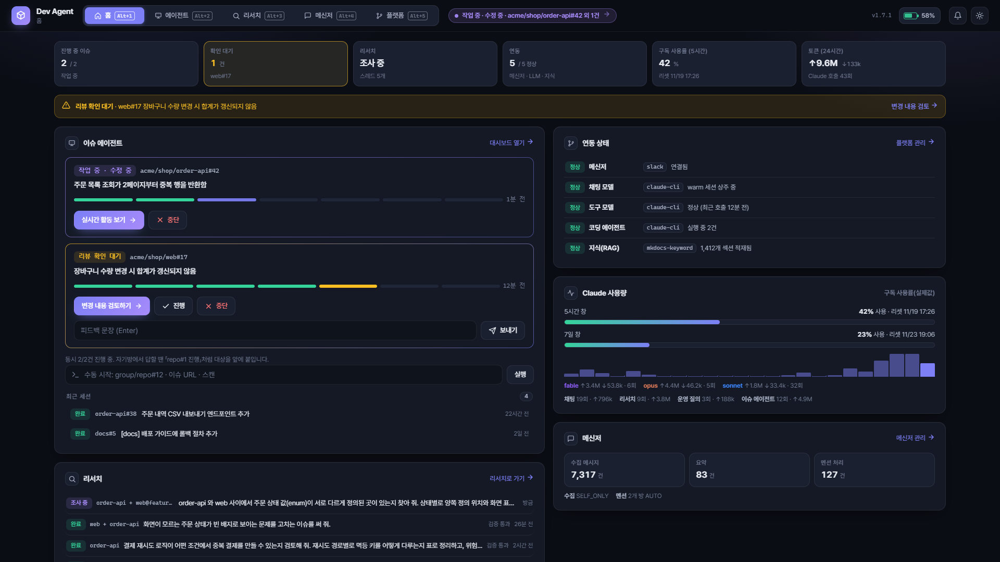
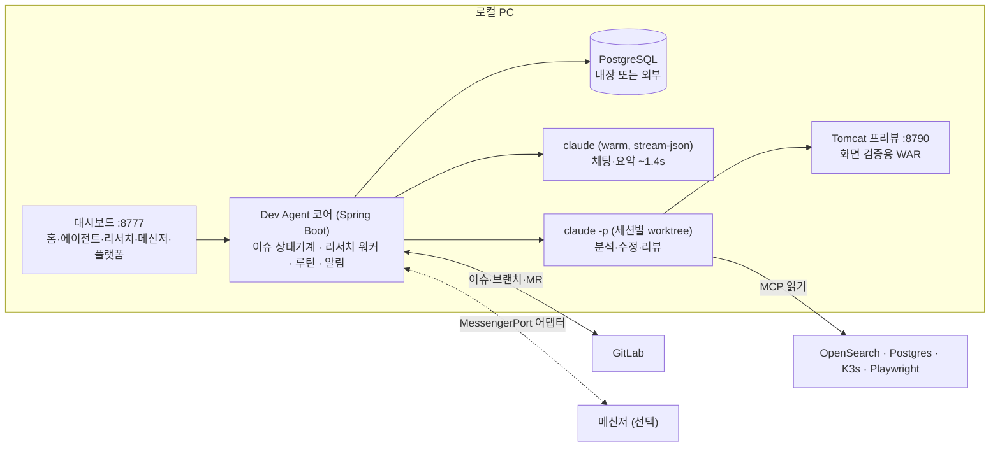
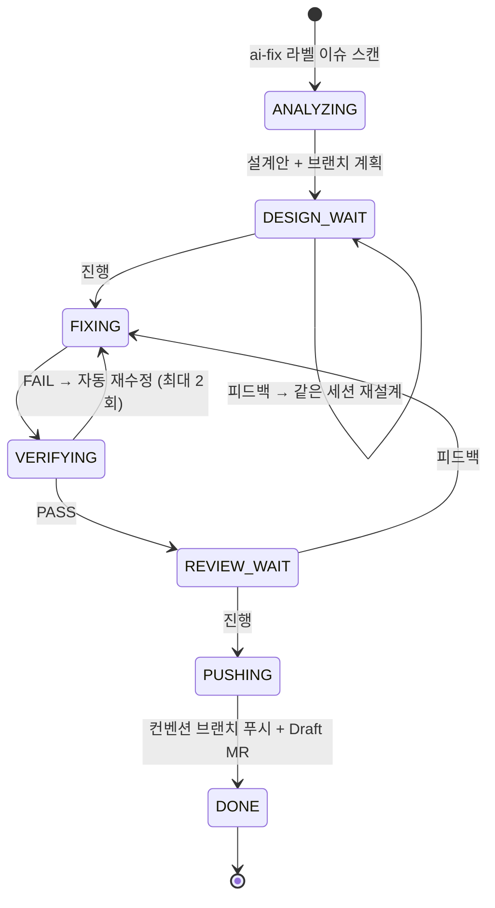
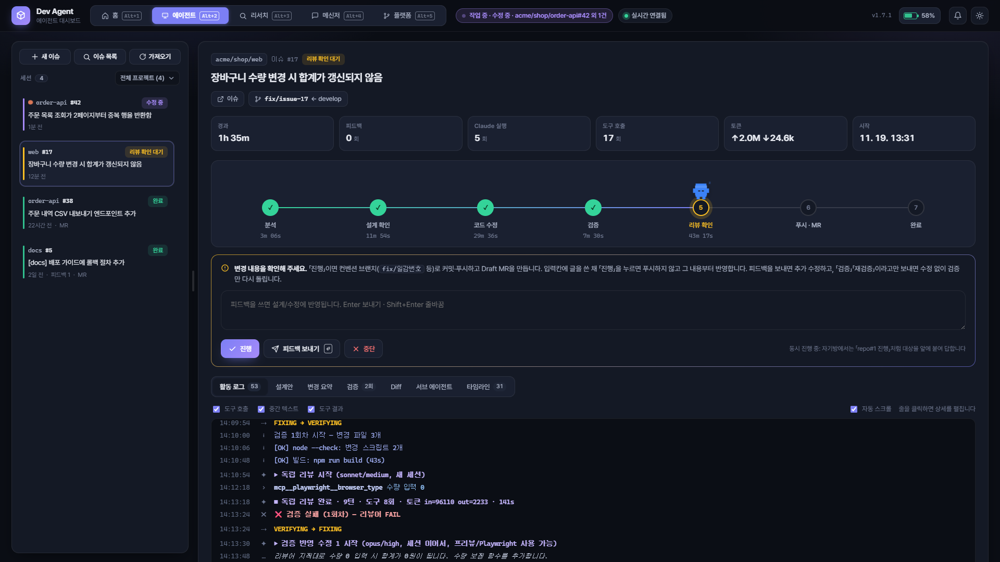
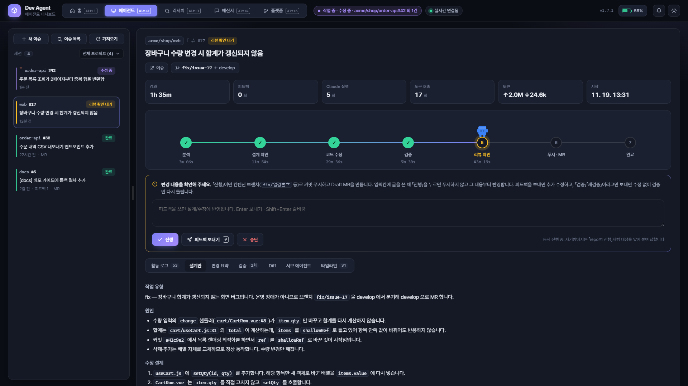
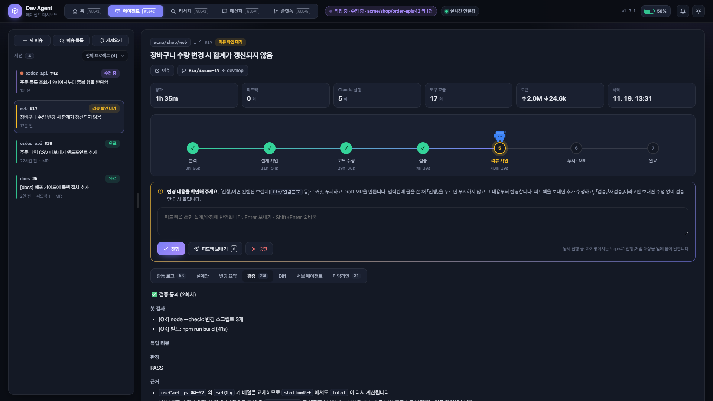
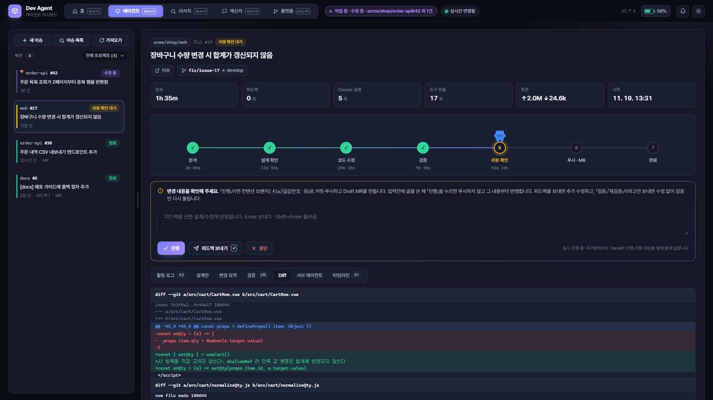
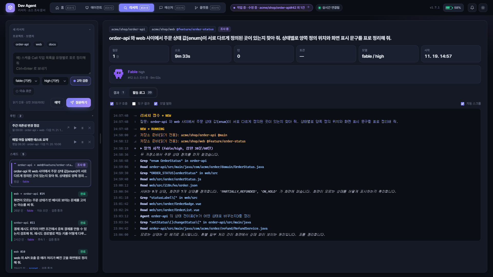
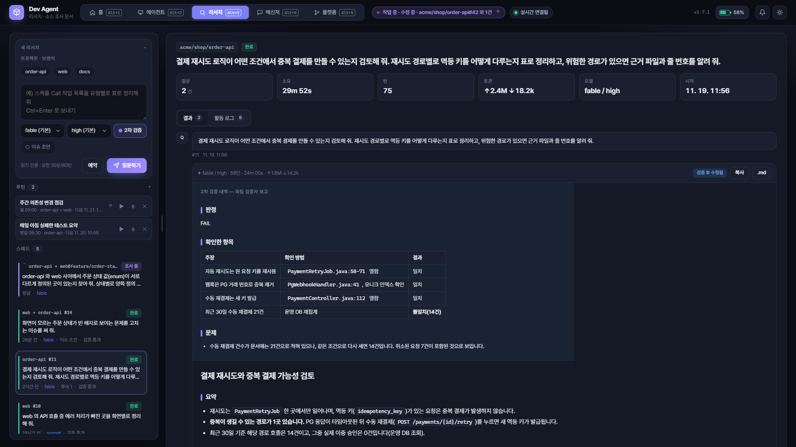
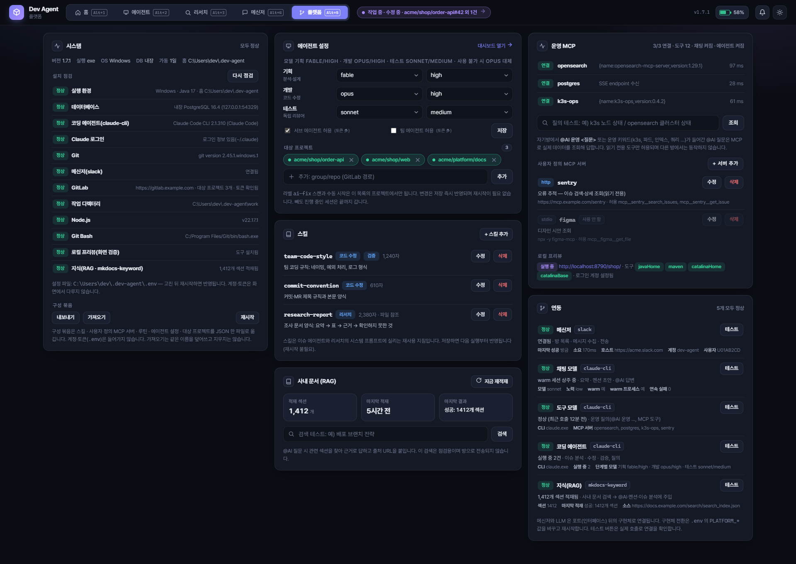

> 라벨이 붙은 GitLab 이슈를 **분석 → 설계 확인 → 수정 → 검증 → 리뷰 확인 → 브랜치 푸시·MR**까지
> 대화형으로 처리하고, 소스를 훑어 문서로 답하는 **리서치**, 예약 실행(**루틴**), 운영 MCP 조회를 한
> 화면에서 다루는 로컬 에이전트 운용 플랫폼이다. 모든 LLM 호출은 API 키 없이 구독 로그인을 쓰는
> **Claude Code CLI(headless)**로 한다. 회사에서 실제 업무에 운영하고 있다.

## Overview

### 왜 만들었나

코딩 에이전트는 이미 쓸 만하지만, 터미널에서 한 번씩 부르는 방식으로는 팀 업무 흐름에 녹이기
어렵다. 이슈를 받아 브랜치를 따고, 고치고, 검증하고, MR을 올리는 반복 절차를 **사람은 확인과
판단만 하고 나머지는 에이전트가 진행**하도록 플랫폼으로 묶는 것이 목표다.

| | AS-IS — 에이전트를 직접 호출 | TO-BE — 플랫폼이 운용 |
|---|---|---|
| 착수 | 이슈를 읽고 직접 프롬프트 작성 | `ai-fix` 라벨만 붙이면 2분 내 자동 착수 |
| 통제 | 에이전트가 끝까지 달리거나, 매번 지켜봐야 함 | 설계 확인 · 리뷰 확인 두 지점에서만 사람이 승인 |
| 신뢰 | 작성한 모델의 "완료" 보고를 믿어야 함 | 빌드·정적검사 + 독립 리뷰어 세션이 PASS/FAIL 판정 |
| 마무리 | 브랜치·커밋·MR을 손으로 정리 | 팀 컨벤션 브랜치로 푸시하고 Draft MR까지 생성 |
| 가시성 | 터미널 로그 | 실시간 활동 로그(SSE), 단계별 모델·토큰 사용량 대시보드 |

### 한눈에 보기

| 기능 | 트리거 | 동작 |
|---|---|---|
| **GitLab 이슈 에이전트** | `ai-fix` 라벨 이슈(2분 스캔) / 화면에서 시작 | 분석 → 설계 확인 → 수정 → 검증(봇 검사 + 독립 리뷰, 실패 시 자동 재수정) → 리뷰 확인 → 컨벤션 브랜치 푸시 → 이슈 코멘트·Draft MR |
| **리서치** | 「리서치」 탭 / `@AI 질문 batch: …` | 대상 저장소를 **읽기 전용** worktree로 조사해 마크다운 문서(요약·표·근거·미확인)로 답변. 후속 질문은 같은 세션을 재사용 |
| **루틴** | 요일·시각 예약 | 정해 둔 질문을 리서치 대기열에 자동 접수 (예: 매주 월 09:00 "지난주 바뀐 배치 잡 정리") |
| **이슈 초안** | 리서치 결과 | 조사 결과를 이슈 형식으로 다시 써서 GitLab 이슈로 등록 → 바로 이슈 에이전트에 연결 |
| **운영 MCP 조회** | `@AI 운영 …` | OpenSearch · PostgreSQL · K3s **읽기 전용** MCP 도구로 실제 운영 데이터를 조회해 답변 |
| **메신저 봇** (선택) | 스케줄 / 멘션 / `@AI` | 대화방 정기 요약, 멘션 초안·자동응답, 사내 문서(RAG) 검색 |

## 아키텍처

### 포트와 어댑터

코어(이슈 에이전트·리서치·요약·멘션)는 **포트(인터페이스)**만 알고, 실제 메신저와 LLM은
**어댑터**가 맡는다. 어댑터는 `platform.*` 설정값에 해당하는 빈만 뜨므로 구현체를 추가하고 값만
바꾸면 교체된다.

| 포트 | 역할 | 현재 어댑터 |
|---|---|---|
| `MessengerPort` | 방 목록 · 메시지 조회 · 전송 | 메신저 없음(기본) — Slack/Discord 등은 어댑터 추가 |
| `ChatModel` | 프롬프트 1건 → 답 1건 | Claude CLI warm 세션 |
| `ToolChatModel` | MCP 도구를 쓰는 one-shot (운영 질의) | Claude CLI |
| `CodingAgent` | 작업 디렉터리에서 도구를 쓰며 여러 턴 | Claude CLI (`claude -p`, stream-json) |
| `KnowledgeSource` | 사내 지식 검색(RAG) | MkDocs 색인 키워드 검색 |

- 전송 안전 정책(자기방 허용, 그 외 화이트리스트, 그룹 차단)은 **코어**에 있어서 메신저를 바꿔도
  그대로 따라온다.
- 모든 포트는 네트워크·LLM 호출 없는 `health()`를, LLM 포트는 토큰을 쓰지 않는 `selfTest()`를
  구현해 플랫폼 탭 "연동" 카드에서 상태와 최근 호출 성공/실패를 보여 준다.

### LLM 접근 — SDK 대신 headless CLI

- **채팅**: 상주 warm 프로세스(`--input-format/--output-format stream-json`)를 두고 20턴마다 리셋,
  실패 시 `claude -p`로 폴백한다. 응답 시간은 콜드스타트 ~20s → 플래그 최적화 ~9.6s →
  **warm 상주 ~1.4s**까지 줄였다.
- **코딩**: 저장소 worktree에서 `claude -p --session-id/--resume`으로 실행하고, stream-json으로 도구
  호출 이벤트를 받아 대시보드에 줄 단위로 흘려보낸다.
- API 키 방식이 필요하면 `ChatModel`/`CodingAgent` 구현체만 추가해 갈아 끼운다.

## GitLab 이슈 에이전트

- **사람은 두 번만 개입한다** — 설계 확인과 리뷰 확인. 대기 중엔 `진행` / `중단` / `피드백: …`으로
  답하고, 피드백은 같은 Claude 세션에 `--resume`으로 이어 붙여 맥락을 잃지 않는다.
- **세션마다 `git worktree`** 를 따로 만들어 동시 2건을 병렬 처리하고, 확인 대기 중에는 다음 이슈
  1건을 미리 분석(`NEW → PREPARING → READY`)해 두었다가 자리가 나면 바로 설계안을 제시한다.
- **단계별 모델 분리** — 기획(분석·설계) / 개발(수정) / 테스트(리뷰어) 모델과 노력을 따로 고르고,
  고른 모델을 쓸 수 없으면 opus로 대체해 같은 세션을 이어 간다. 스테퍼에는 단계별로 실제 쓴 모델이
  표시된다.
- **참고 저장소** — 마이그레이션 이슈처럼 다른 서비스 코드를 봐야 할 때, 이슈 본문에 적은 저장소를
  읽기 전용 detached worktree로 받아 두고 실행 뒤 변경이 생기면 되돌린다.

| 설계안 | 검증 | Diff |
|---|---|---|
|  |  |  |

### 검증 — 작성자를 믿지 않는 구조

코드를 쓴 모델의 "완료" 보고와 무관하게 두 겹으로 확인한다.

1. **봇 검사** — 바뀐 `.js`는 `node --check`, `.jsp`는 Tomcat JspC 기반 `jspcheck`, 빌드는
   `mvn -o compile` / `gradlew compileJava` 등 프로젝트별 명령.
2. **독립 리뷰어** — 수정 세션과 분리된 새 Claude 세션(읽기 전용)이 이슈·설계·diff·검사 결과·
   스크린샷을 보고 `판정 PASS|FAIL / 근거 / 수정 요청`으로 답한다.

FAIL이면 보고 전체를 같은 수정 세션에 돌려보내 **자동 재수정**(최대 2회)하고, 그래도 실패하면
실패 내역과 함께 사람의 판단으로 넘긴다.

**화면 검증**: Spring MVC + JSP처럼 WAR가 떠야 화면을 볼 수 있는 프로젝트를 위해, 에이전트가
`preview deploy`로 worktree를 빌드해 로컬 Tomcat에 올리고 **Playwright MCP**로 직접 재현·확인하며
스크린샷을 남긴다. 이후 JSP/JS/CSS 변경은 `preview sync`로 전개 디렉터리에 복사만 해 반복 확인을
수 초 단위로 줄였다.

### 브랜치 · 커밋 컨벤션

- 브랜치 `{feature|fix|refactor|doc|hotfix}/{일감번호}` — 유형은 분석 결과와 라벨로, 일감번호는 이슈
  제목에서 정규식으로 추출한다.
- 일반 작업은 `develop` 기준, hotfix는 `main` 기준. MR 제목은 `Draft: <커밋 제목>`.
- **git commit/push는 Claude가 아니라 봇이 한다.** 컨벤션 접두어 브랜치에만 푸시할 수 있고
  main/develop 직접 푸시·강제 푸시는 코드에서 막는다. 토큰은 `.git/config`에 남기지 않고 명령별
  `http.extraheader`로만 주입한다.

## 리서치 · 루틴

이슈→개발이 아니라 **"Batch job 목록 정리해 줘"**처럼 소스를 훑어 정리해 달라는 요청용이다.

- 대상 저장소(복수)마다 **브랜치를 골라** 읽기 전용 worktree로 받는다. 같은 저장소를 브랜치만 달리해
  넣으면 브랜치 간 비교 질의가 된다.
- 결과는 `# 제목 / ## 요약 / ## 내용(표) / ## 근거(파일 경로) / ## 미확인·주의` 고정 틀. 후속
  질문은 같은 세션을 `--resume`해 이미 읽은 코드 맥락을 재사용한다(빠르고 토큰이 적다).
- **2차 검증** — 문서를 쓴 뒤 독립 검증자 세션이 수치를 다시 세고, 목록의 누락·과잉을 찾고, 근거
  경로를 표본 확인해 PASS/FAIL을 낸다. 결과 문서에 `검증 통과` / `검증 후 수정됨` 등 배지가 붙는다.
- **루틴** — 같은 질문을 정해 둔 요일·시각마다 리서치 대기열에 접수한다. PC가 꺼져 있었다면 같은 날
  켜질 때 한 번만 따라잡는다.
- **이슈 초안** — 리서치 결과를 이슈 형식으로 다시 써서 GitLab에 등록하면, 그대로 이슈 에이전트가
  분석을 시작한다. 등록은 항상 사람이 확인하고 누른다.

## 운영을 위한 설계

실제 업무에서 매일 돌리면서 필요해진 장치들이다.

### 구독 사용량 한도 대응

구독제라 비용 대신 **토큰**을 본다. 상단바 배터리 게이지가 5시간 창의 남은 사용률을 보여 주고, 모든
Claude 호출은 `claude_usage` 테이블에 모델별·출처별로 기록된다.

CLI는 한도에 걸리면 오류가 아니라 `You've hit your session limit · resets 2:20pm` 텍스트를 내고 0턴으로
끝난다(실측). 봇은 이 문장을 감지해 리셋 시각을 읽고 단계별로 다르게 처리한다.

| 걸린 단계 | 처리 |
|---|---|
| 분석 | 큐(NEW)로 되돌리고, 리셋 전에는 새 세션을 시작하지 않음 → 리셋 뒤 자동 재분석 |
| 수정 | 작업트리 변경을 보존한 채 리뷰 대기로 → 리셋 뒤 같은 세션을 자동 「이어서 진행」 |
| 검증 리뷰어 | 봇 검사 결과만으로 리뷰 대기 → 리셋 뒤 검증 자동 재실행 |
| 리서치 | 대기열에 두었다가 리셋 뒤 자동 시작 |

### 실행 상한과 중단

- 단계별 상한: 분석 60분/80턴, **개발 4시간/600턴**, 리뷰어 60분, 도구 호출·출력이 전혀 없는
  무응답 20분이면 중단.
- 개발 상한을 넘기면 변경을 보존한 채 리뷰 대기로 넘기고 「피드백: 이어서 진행」으로 재개한다.
- 「중단」은 Claude 프로세스와 자식 프로세스(gradle/node, 리뷰어 세션)까지 즉시 종료한다.
- 답변은 접수 시점의 대기 단계를 기억해, 「진행」 두 번이 다음 단계 승인으로 번지지 않게 한다.

### 안전장치

- 모든 화면은 `127.0.0.1` 전용. 계정·토큰은 `.env` 밖으로 나가지 않고 화면에서 다루지 않는다.
- 운영 MCP는 **읽기 전용** 도구만 허용. 사용자 정의 MCP 서버의 인증 헤더는 `${ENV}` 자리표시자만
  받는다.
- PowerShell 도구는 권한 패턴을 우회하므로 금지(`--disallowedTools`)하고, 에이전트가 쓸 스크립트는
  `~/bin` 심으로 제공한다.
- 메신저 봇이 만든 메시지(`[방 요약]`, `[자동응답]`, `[이슈]` …)는 수집·답변에서 제외해 루프를 막는다.

### 팀 배포

에이전트는 각자의 Claude 구독 로그인, GitLab 토큰으로 동작한다. 한 서버에 올리면 한 사람의 구독과
권한을 여럿이 나눠 쓰게 되어 한도와 책임이 섞이므로, **각자 PC에서 실행 파일로** 띄우는 것을
기본으로 했다.

- **실행 파일 패키지** — jpackage + jlink로 Java 런타임과 내장 PostgreSQL을 담은 `Dev Agent.exe`.
  받는 사람은 Claude Code와 Git만 준비하면 된다. 감시자(Launcher) 프로세스가 트레이 아이콘과 앱
  JVM을 관리하고, 비정상 종료 시 다시 띄운다.
- **설치 점검** — DB · CLI · Claude 로그인 · Git · GitLab 토큰 · Node.js 등을 항목별로 점검하고 고치는
  방법을 한 줄로 안내한다.
- **구성 묶음** — 팀의 스킬 · MCP 서버 · 루틴 · 모델 설정 · 대상 프로젝트를 비밀값 없이 JSON 한
  파일로 내보내고 가져온다.
- **스킬** — 팀 코딩 규칙·커밋 규칙·조사 문서 양식을 플랫폼이 관리하고 단계별 시스템 프롬프트에
  주입한다. Claude Code 네이티브 스킬이 아니라서 다른 LLM 구현체로 바꿔도 유지된다.

## 기술 스택

| 영역 | 기술 |
|---|---|
| Backend | Java 17, Spring Boot 3.3, MyBatis |
| Database | PostgreSQL 16 (내장 또는 외부) |
| LLM / Agent | Claude Code CLI (headless, stream-json), MCP (OpenSearch · PostgreSQL · K3s · Playwright) |
| Frontend | Vanilla JS + 공통 디자인 시스템(`ui.css`/`ui.js`), SSE 실시간 로그 |
| 배포 | jpackage · jlink 실행 파일, 포터블 jar, 자동 실행 · supervisor |
| 연동 | GitLab REST API, git worktree, Tomcat 프리뷰 |
