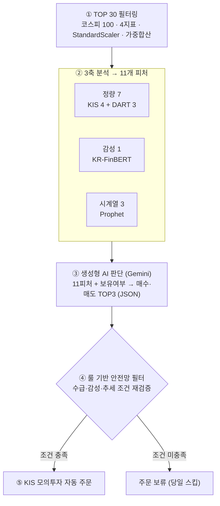

> 매 거래일 KOSPI 100 종목을 다축으로 분석해 11개 피처를 산출하고, 생성형 AI(Gemini)의 유연한
> 판단과 룰 기반 안전망의 안정성을 결합한 이중 검증 구조로 매수/매도를 결정해 KIS 모의투자
> API로 자동 주문하는 시스템이다.

## Overview

### 왜 만들었나

사람이 매일 반복하는 주식 분석·매매 루틴을, 감정을 배제한 데이터 기반 자동 파이프라인으로
옮기는 것이 목표다.

| | AS-IS — 사람의 수동 매매 | TO-BE — 데이터 기반 자동 파이프라인 |
|---|---|---|
| 시간 | 점검 항목이 많아 시간 소모 | 사람 개입 없이 동일 루틴 반복 |
| 범위 | 대상 종목 수가 곧 분석의 한계 | 대상을 좁히고 다축으로 동시 분석 |
| 일관성 | 동일 상황에도 판단이 흔들림 | 감정 없이 일관된 기준으로 실행 |
| 재현성 | 의사결정 근거를 재현하기 어려움 | 근거가 구조화된 매수/매도 후보 산출 |

> 단일 지표보다 여러 신호를 종합할 때 투자 판단이 효율적이라는 선행연구(Lopez-Lira & Tang,
> 2023 · JP Morgan LOXM)에 근거해 "종합 판단" 구조를 채택했다.

### 시스템 구조

수집·분석·판단 / 매매 실행 / 표시 / 저장을 분리한 서비스들을 하나의 모노레포(Docker
Compose)로 운영한다.

| 모듈 | 역할 | 기술 스택 | 포트 |
|---------|------|----------|------|
| `ai-agent` | 수집 · 3축 분석 · Gemini 판단 · 안전망 (파이프라인 코어) | Python, FastAPI, APScheduler, scikit-learn, Prophet, KR-FinBERT | 8000 |
| `api-server` | 인증 · 매매 실행(KIS) · 거래내역 · 시장분석 조회 API | Spring Boot 4.1, JPA, Spring Security + JWT, Jasypt, Liquibase | 7070 |
| `web-app` | 대시보드 · AI 분석 4탭 · 시각화 (PWA) | Vue 3, Vite, Tailwind CSS, Pinia | 5173 (dev) |
| `database` | 분석 결과 · 예측 · 판단 · 거래 이력 영속 저장 | PostgreSQL 16 (17 tables + 4 views) | 5432 |

> 매 거래일(평일) 08:50 KST에 전체 분석 파이프라인(Stage 1~6)이 자동 실행된다. web-app은
> ai-agent를 직접 호출하지 않으며, ai-agent가 DB에 적재한 분석 결과를 api-server를 통해
> 조회한다.

### 분석 프로세스

코스피 100 스캔부터 자동 주문까지 한 거래일의 전체 흐름이다.

#### 단계별 요약

| 단계 | 핵심 | 산출 |
|------|------|------|
| ① TOP 30 필터링 | 코스피 100 풀 고정 → 4개 지표(외국인·기관 순매수, 거래량 배율, 가격 변동성)를 StandardScaler로 매일 새로 정규화 → 가중합산(\|외국인\|·0.3 + \|기관\|·0.3 + 거래량·0.3 + 변동성·0.1) | 상위 30종목 (보유 종목 강제 포함) |
| ② 정량분석 (KIS 4 + DART 3) | KIS 시세·수급(morning_return, close_position, 외국인·기관 순매수) + DART 분기 재무(PER·ROE·영업이익률, 분기 1회 갱신·매일 DB 조회) | 7개 피처 |
| ② 감성분석 (KR-FinBERT) | 2트랙 분리 — 시장 전반(RSS 3개사 → 대시보드) / 종목별(네이버 금융 5건 → 시간 가중 평균). 제목+본문 200자, P(긍)−P(부) | sentiment_score 1개 |
| ② 시계열 예측 (Prophet) | 종목별 120거래일 독립 학습 → D+1~D+5 예측 → 선형회귀 기울기로 추세 방향·강도 수치화 | 가격 추세·거래량 추세·불확실성 3개 |
| ③ AI 판단 (Gemini) | "AI 트레이딩 어드바이저" 페르소나, 6가지 판단 기준(수급·모멘텀·펀더멘탈·뉴스·추세·불확실성), JSON 출력 강제 | 매수·매도 각 TOP3 + 근거 |
| ④ 안전망 필터 | 수급·감성·추세 조건을 룰로 재검증해 Gemini 자유도를 제어. 미충족 시 자동 보류 | 실행/보류 결정 |
| ⑤ 매매 실행 | is_active=true일 때 api-server를 통해 KIS 모의투자 주문 | 주문 체결 |

> 이중 검증 구조: 1차로 생성형 AI(Gemini)가 수치로 표현하기 어려운 맥락까지 유연하게 종합
> 판단하고, 2차로 룰 기반 안전망이 수급·감성·추세 조건을 다시 검증해 과도한 판단을 차단한다.
> 리뷰어 LLM을 두는 방식 대비 비용은 낮고 신뢰성은 높다.
