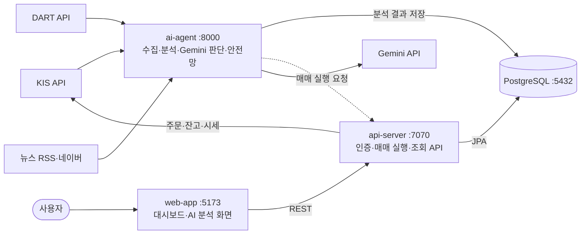
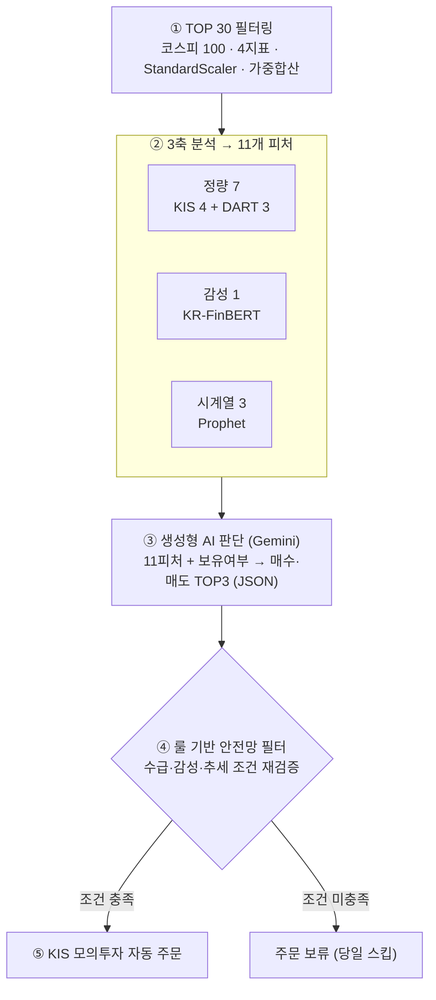
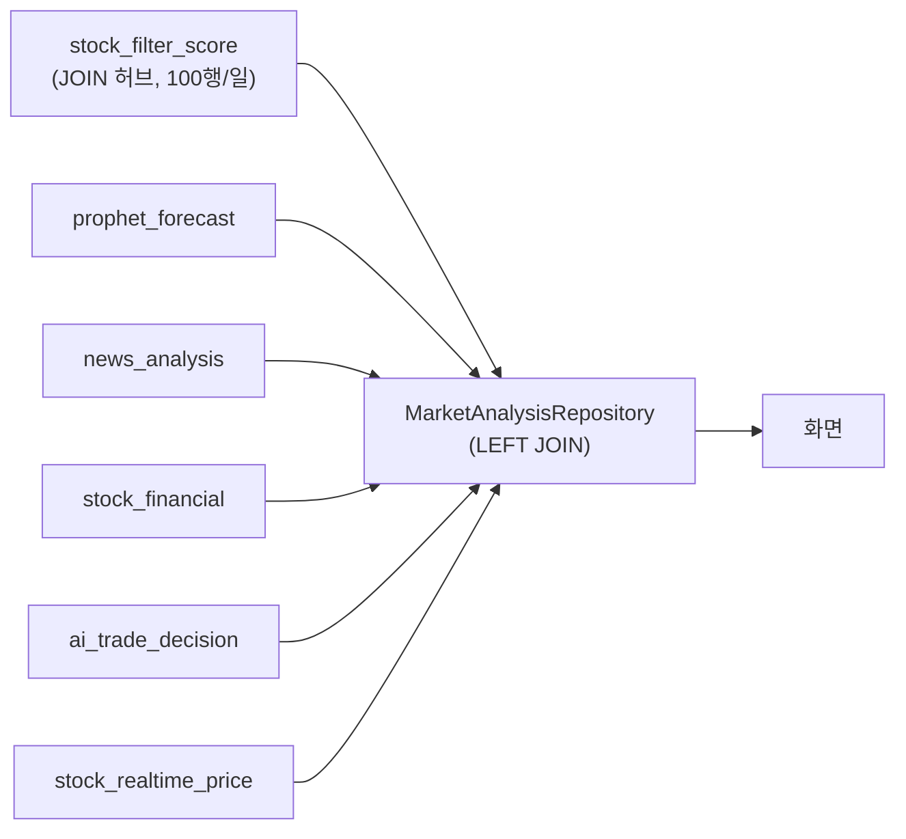
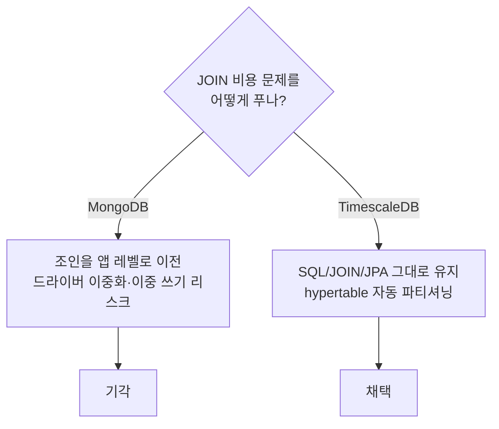
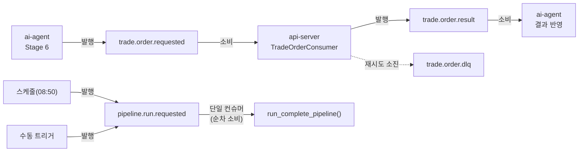
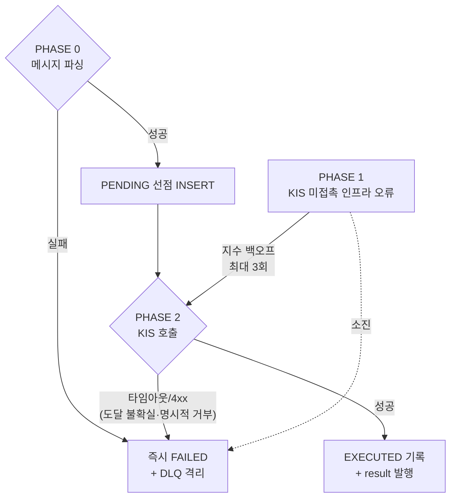
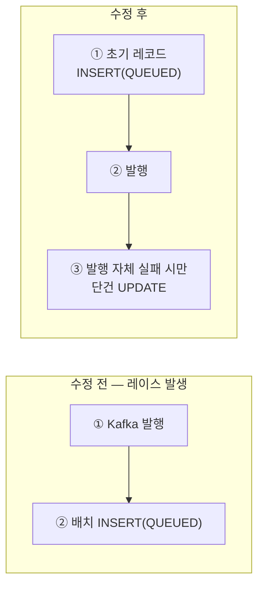
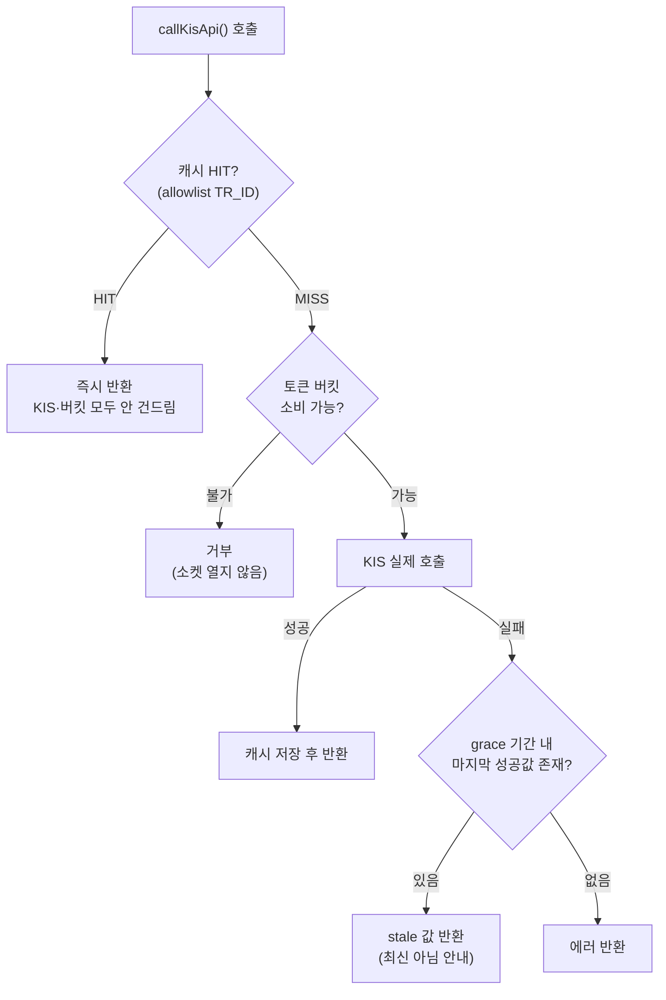
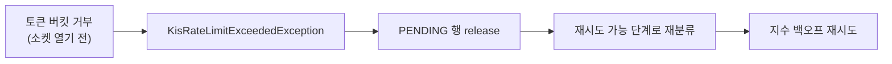

> 매 거래일 KOSPI 100 종목을 다축으로 분석해 11개 피처를 산출하고, 생성형 AI(Gemini)의 유연한
> 판단과 룰 기반 안전망의 안정성을 결합한 이중 검증 구조로 매수/매도를 결정해 KIS 모의투자
> API로 자동 주문하는 시스템이다.

## Overview

### 왜 만들었나

사람이 매일 반복하는 주식 분석·매매 루틴을, 감정을 배제한 데이터 기반 자동 파이프라인으로
옮기는 것이 목표다.

| | AS-IS — 사람의 수동 매매 | TO-BE — 데이터 기반 자동 파이프라인 |
|---|---|---|
| 시간 | 점검 항목이 많아 시간 소모 | 사람 개입 없이 동일 루틴 반복 |
| 범위 | 대상 종목 수가 곧 분석의 한계 | 대상을 좁히고 다축으로 동시 분석 |
| 일관성 | 동일 상황에도 판단이 흔들림 | 감정 없이 일관된 기준으로 실행 |
| 재현성 | 의사결정 근거를 재현하기 어려움 | 근거가 구조화된 매수/매도 후보 산출 |

> 단일 지표보다 여러 신호를 종합할 때 투자 판단이 효율적이라는 선행연구(Lopez-Lira & Tang,
> 2023 · JP Morgan LOXM)에 근거해 "종합 판단" 구조를 채택했다.

### 시스템 구조

수집·분석·판단 / 매매 실행 / 표시 / 저장을 분리한 서비스들을 하나의 모노레포(Docker
Compose)로 운영한다.

| 모듈 | 역할 | 기술 스택 | 포트 |
|---------|------|----------|------|
| `ai-agent` | 수집 · 3축 분석 · Gemini 판단 · 안전망 (파이프라인 코어) | Python, FastAPI, APScheduler, scikit-learn, Prophet, KR-FinBERT | 8000 |
| `api-server` | 인증 · 매매 실행(KIS) · 거래내역 · 시장분석 조회 API | Spring Boot 4.1, JPA, Spring Security + JWT, Jasypt, Liquibase | 7070 |
| `web-app` | 대시보드 · AI 분석 4탭 · 시각화 (PWA) | Vue 3, Vite, Tailwind CSS, Pinia | 5173 (dev) |
| `database` | 분석 결과 · 예측 · 판단 · 거래 이력 영속 저장 | PostgreSQL 16 (17 tables + 4 views) | 5432 |



> 매 거래일(평일) 08:50 KST에 전체 분석 파이프라인(Stage 1~6)이 자동 실행된다. web-app은
> ai-agent를 직접 호출하지 않으며, ai-agent가 DB에 적재한 분석 결과를 api-server를 통해
> 조회한다.

### 분석 프로세스

코스피 100 스캔부터 자동 주문까지 한 거래일의 전체 흐름이다.



#### 단계별 요약

| 단계 | 핵심 | 산출 |
|------|------|------|
| ① TOP 30 필터링 | 코스피 100 풀 고정 → 4개 지표(외국인·기관 순매수, 거래량 배율, 가격 변동성)를 StandardScaler로 매일 새로 정규화 → 가중합산(외국인·0.3 + 기관·0.3 + 거래량·0.3 + 변동성·0.1) | 상위 30종목 (보유 종목 강제 포함) |
| ② 정량분석 (KIS 4 + DART 3) | KIS 시세·수급(morning_return, close_position, 외국인·기관 순매수) + DART 분기 재무(PER·ROE·영업이익률, 분기 1회 갱신·매일 DB 조회) | 7개 피처 |
| ② 감성분석 (KR-FinBERT) | 2트랙 분리 — 시장 전반(RSS 3개사 → 대시보드) / 종목별(네이버 금융 5건 → 시간 가중 평균). 제목+본문 200자, P(긍)−P(부) | sentiment_score 1개 |
| ② 시계열 예측 (Prophet) | 종목별 120거래일 독립 학습 → D+1~D+5 예측 → 선형회귀 기울기로 추세 방향·강도 수치화 | 가격 추세·거래량 추세·불확실성 3개 |
| ③ AI 판단 (Gemini) | "AI 트레이딩 어드바이저" 페르소나, 6가지 판단 기준(수급·모멘텀·펀더멘탈·뉴스·추세·불확실성), JSON 출력 강제 | 매수·매도 각 TOP3 + 근거 |
| ④ 안전망 필터 | 수급·감성·추세 조건을 룰로 재검증해 Gemini 자유도를 제어. 미충족 시 자동 보류 | 실행/보류 결정 |
| ⑤ 매매 실행 | is_active=true일 때 api-server를 통해 KIS 모의투자 주문 | 주문 체결 |

> 이중 검증 구조: 1차로 생성형 AI(Gemini)가 수치로 표현하기 어려운 맥락까지 유연하게 종합
> 판단하고, 2차로 룰 기반 안전망이 수급·감성·추세 조건을 다시 검증해 과도한 판단을 차단한다.
> 리뷰어 LLM을 두는 방식 대비 비용은 낮고 신뢰성은 높다.

## Troubleshooting

### 1. 시계열 데이터 TimescaleDB 마이그레이션

대용량 시계열 데이터 관리 효율·성능 개선 작업의 기록. 문제, 결정, 실측 결과를 남긴다.

#### 문제

`api-server`의 `MarketAnalysisRepository`는 `stock_filter_score`(KOSPI 100 전체, 100행/일)를
허브로 5개 테이블을 LEFT JOIN해 화면 데이터를 조립한다. 데이터가 몇 년치 누적되면 이 JOIN
비용이 계속 불어나는 구조다.



쿼리는 대부분 인덱스가 있는 단일 날짜 조회라 지금 당장 느리진 않지만, 테이블이 계속 커지면
심각해질 문제라 미리 손보기로 했다.

#### 대안 검토: MongoDB vs TimescaleDB

기능 카드의 원안은 "NoSQL로 마이그레이션"이었다 — NoSQL이 대용량 데이터에 강하다는 통념과,
시계열 데이터 특성상 수평 확장이 유리할 거라는 판단이 근거였다.



최종 선택: TimescaleDB. PostgreSQL 확장이라 SQL/JOIN/JPA가 그대로 동작하고, 문제의 본질(테이블이
커질수록 조회가 느려짐)을 정확히 겨냥한 해법이면서 마이그레이션 리스크는 "테이블 선언 +
`create_hypertable()` 한 줄"에 가깝다. NoSQL 전환 자체가 목적이 아니라 실제 문제 해결이
목적이었다.

#### 마이그레이션 대상

JOIN 허브 역할을 하는 4개 테이블을 우선 전환했다: `asset_daily_snapshot`(1차 파일럿, 조인 없어
리스크 최소), `stock_filter_score`(핵심 JOIN 허브), `prophet_forecast`, `news_analysis`. 매매
원장(`trade_history`)과 분기 갱신 테이블(`stock_financial`) 등 조인 허브가 아니거나 볼륨이 작은
테이블은 이번 스코프 밖으로 남겼다.

#### 핵심 구현 결정

**hypertable PK 제약**: TimescaleDB는 PK/UNIQUE 제약이 파티션 컬럼을 포함해야 해서, 4개 테이블
모두 `id` 단독 PK를 `(id, 날짜)` 복합키로 바꿨다. api-server `AssetDailySnapshot` 엔티티에는
`@IdClass`를 적용했다.

**청크 스캔 회귀 발견·수정**: 전환 후 EXPLAIN으로 확인하니, `ai-agent`의 "행을 로드해서 고치고
저장" 방식 UPDATE가 모든 chunk에 index scan을 거는 fan-out이 되어 있었다 — 마이그레이션
목적(조회 성능 개선)을 이 경로에서 정반대로 만들 수 있는 지점이었다.

```diff
- record = session.query(StockFilterScore).filter(stock_code=.., score_date=..).first()
- record.morning_return = morning_return
- session.commit()
+ session.query(StockFilterScore).filter(stock_code=.., score_date=..).update(
+     {StockFilterScore.morning_return: morning_return}, synchronize_session=False)
+ session.commit()
```

`score_date`가 WHERE에 남아 단일 chunk로 배제되도록 고쳤다.

#### 검증 및 성능

Testcontainers(`timescale/timescaledb:latest-pg16`)에 실제 프로덕션 Liquibase changelog를
적용해 hypertable 등록·제약·upsert·실제 3중 LEFT JOIN 쿼리·프로덕션 리포지토리 실호출까지
검증하는 17개 테스트를 작성했다. 기존 테스트(api-server 491개, ai-agent 740개) 전부 회귀 없음.

평일만·10년치·종목 1,000개(2,610,000행) 기준 실측:

| 시나리오 | 일반 테이블 | hypertable | 결과 |
|---|---|---|---|
| 점 조회 (단일 날짜) | 0.406ms | 0.096ms | 4.2배 빠름 |
| 오래된 데이터 정리 | ~5.7초 (전체 배타 락) | 202ms (락 없음) | 28배 빠르고 무중단 |
| 압축 (30일 chunk 튜닝) | 295MB | 197MB | 33% 작음 |
| 실제 range 조회 (getHistory(), 비집계) | 2.348ms | 2.373ms | 오차범위 내 동일 |

넓은 범위를 GROUP BY로 집계하는 쿼리는 오히려 hypertable이 느렸지만(현재 코드엔 이런 쿼리가
없음), 실제로 존재하는 모든 쿼리 패턴에서는 개선되거나 손해가 없었다.

#### 최종 결과

JOIN 허브 4개 테이블을 hypertable로 전환해, 테이블이 계속 커져도 현재 코드가 실제로 쓰는 조회
패턴의 성능이 유지되도록 만들었다.

- 점 조회 4배, 데이터 정리 28배(+무중단), 압축 33% 절감을 실측으로 확인했다.
- 실제로 쓰이는 range 조회는 손해 없이 동일 — 전환이 기존 기능을 퇴행시키지 않았다.
- 전환 과정에서 청크 스캔 회귀 1건을 발견해 즉시 수정했고, 신규 테스트 17개 + 기존 1,231개
  전부 통과, 데이터 손실 없이 반영했다.

#### 향후 과제

- `chunk_time_interval` 튜닝: 기본값(7일)은 range 집계에 비효율적 — 30일 안팎으로 조정 필요.
- retention/압축 정책 자동화: 실측에서 가장 큰 이득이 나온 영역이라 `drop_chunks()`/
  `add_compression_policy` 기반 자동화가 다음 단계.
- 스코프 밖 테이블 재검토: `stock_news`, `trade_history`는 조회가 느려지거나 거래 이력이 충분히
  쌓이면 후속 전환을 고려한다.

### 2. 매매 실행 신뢰성 개선: Kafka 메시지 큐 도입

ai-agent(분석 파이프라인)와 api-server(매매 실행) 사이에 있던 두 가지 신뢰성 문제를 Kafka로
해결한 기록. 결정 근거, 핵심 구현, 실측 결과를 남긴다.

#### 문제

이슈 1 — 매매 주문 유실. ai-agent Stage 6이 api-server를 동기 HTTP로 호출하는데 실패 시
재시도가 없었다. api-server가 다운되거나 KIS가 타임아웃되면 주문이 영구히 사라지고 파이프라인은
"성공"으로 마감됐다. `trade_history`에도 기록이 남지 않아 매매 감사 로그가 시스템 어디에도
없었다.

이슈 2 — 파이프라인 동시 실행 방지 부재. 스케줄 트리거와 수동 트리거가 동시 실행을 막는 락 없이
각각 파이프라인을 실행할 수 있어, 겹치면 동일 유저에게 중복 매수 주문이 나갈 수 있었다.

#### 왜 Kafka인가

두 이슈 모두 "요청과 실행을 분리하고, 실행이 실패해도 요청이 사라지지 않게 하는 것"이 본질이라
Kafka의 Producer/Consumer 모델과 맞아떨어진다. RabbitMQ·Redis Streams·SQS 대신 Kafka를 고른
이유:

- 파티션 기반 순서 보장: 동일 키(`userId:stockCode:tradeDate:side`) 메시지가 같은 파티션에
  순서대로 쌓여 멱등성 로직이 단순해진다.
- 향후 확장 여지: Gemini 결정 큐잉 등 이벤트 스트림을 계속 늘려나갈 걸 감안하면 생태계가 넓은
  Kafka가 유리하다.
- 낮은 도입 비용: 이미 다뤄본 기술이라 학습 곡선 없이 바로 프로덕션 수준으로 붙일 수 있었다.

조사 후보 5개(주문 유실, 파이프라인 동시성, Gemini 큐잉, 종목 단위 재시도, Stage 체크포인트) 중
설계가 확정된 이슈 1·2만 이번에 구현했다 — 나머지는 처리량 이득이 없거나(종목 재시도), 선행
리팩터링이 필요하거나(Stage 체크포인트), 정책이 미확정(Gemini 큐잉)이라 제외했다. 이슈 1의
멱등키는 이슈 2의 잔여 리스크(중복 실행 시 중복 주문)까지 막아주는 안전망 역할도 한다(검증
단계에서 실측 확인).

#### 메시지 계약 & 토폴로지

api-server·ai-agent를 독립적으로 작업시키기 위해 스펙을 먼저 고정했다: 메시지 8개 필드, 멱등키는
record key와 body 양쪽에 채워 컨슈머가 어느 쪽을 읽어도 안전하게 했다.



#### 핵심 구현

PENDING 선(先) claim + PHASE 기반 재시도. KIS 호출 전에 PENDING 행을 선점 INSERT해, 프로세스가
죽어도 재실행 흔적이 남게 했다. 재시도 여부는 "KIS를 호출했는가"로 가른다 — 이미 건드린 실패는
도달 여부가 불확실해 즉시 DLQ, 아직 안 건드린 인프라 오류만 재시도한다.



파이프라인 직렬화: 스케줄·수동 트리거 모두 `pipeline.run.requested`에 발행하고 단일 컨슈머가
순차 소비하도록 바꿔, 수동 트리거는 발행 직후 즉시 202를 반환한다(이전엔 전체가 끝날 때까지
동기 대기).

발행-INSERT 순서 레이스 발견·수정: KIS를 호출하지 않고 즉시 실패를 반환하는 초고속 경로에서,
결과가 배치 INSERT보다 먼저 도착해 이미 확정된 실패가 `QUEUED`로 덮이는 레이스가 있었다.



결과가 도착할 수 있는 시점보다 행이 항상 먼저 존재하도록 순서를 뒤집었고, 이 레이스를 재현하는
테스트 5개로 수정 전 전부 실패·수정 후 전부 통과를 확인했다.

#### 검증 및 실측 결과

Testcontainers로 실제 Kafka+PostgreSQL을 띄워 프로덕션 코드 경로를 검증했다: 동일 키 3회 발행에도
KIS 호출 1회(멱등성), KIS 타임아웃/4xx는 재시도 없이 즉시 DLQ, 인프라 오류만 재시도 후 DLQ. 메시지
계약을 독립 구현한 두 서비스가 실제로 같은 메시지를 주고받는지도 직렬화 바이트 단위로 정적
대조해 7개 계약 항목 전부 일치를 확인했다. 회귀 없음 — api-server 491+7개, ai-agent 740→864개
전부 통과.

| 항목 | 실측 결과 |
|---|---|
| 파이프라인 트리거 응답 시간 | 동기 대기(수십 분) → 발행 후 즉시 응답(수 ms~30ms) |
| 동시 트리거 시 최대 동시 실행 수 | 1 (반복 실측에서 한 번도 2를 넘지 않음) |
| 멱등성의 중복 실행 방지 효과 | 동일 거래일 2회 실행 → 메시지 2건 발행, 실제 KIS 호출은 1건 |

마지막 행이 설계 의도("이슈 1의 멱등키가 이슈 2의 잔여 리스크도 막아준다")가 실측으로 성립함을
보여준다.

#### 최종 결과

Kafka Producer/Consumer 모델로 주문 요청·파이프라인 트리거를 큐에 발행하는 구조로 바꿔, 두
신뢰성 문제를 브로커 레벨의 재시도·DLQ·직렬 소비로 해소했다.

- 주문 유실 해소: PENDING 선점 + DB UNIQUE 이중 방어로 동일 메시지 3회 발행에도 KIS 호출 1회만
  발생.
- 파이프라인 동시 실행 방지: 실측상 항상 순차 처리, 요청 유실 없음.
- 응답성 개선: 트리거 응답이 수십 분 동기 대기에서 수 ms~30ms로.
- 회귀 없이 반영: api-server·ai-agent 전체 테스트 통과 + 독립 구현된 메시지 계약 7개 항목 전부
  일치.

#### 향후 과제

- outbox 패턴 부재: 결과 발행이 `trade_history` 원장 기록과 원자적이지 않다. 지금은 실용적
  타협이지만 트래픽이 늘면 재검토 대상.
- 운영 관측성 부재: PENDING/QUEUED 잔여 행이나 DLQ 격리 메시지를 사람이 확인할 알람·도구가 아직
  없다.
- 실 인프라 end-to-end 미검증: 두 서비스를 하나의 브로커에 동시에 붙여 실행하는 end-to-end
  테스트, 실 KIS 모의계좌 크레덴셜 동작은 아직 검증하지 않았다.

### 3. 외부 API 의존성 격리: Redis 기반 Rate Limit·캐싱 도입

KIS(한국투자증권) Open API 호출에 상한이 없고 종목 상세 조회에 캐싱이 없던 문제를 Redis 기반
토큰 버킷과 응답 캐시로 해결한 기록.

#### 문제

api-server의 `KisApiClient`는 KIS 호출부 15곳 이상이 거쳐가는 단일 관문인데(OAuth 토큰 발급
4곳은 이 관문 밖에서 각자 호출한다), rate limit이 전혀 없었다. 두 경로가 위험했다:

- 종목 상세 조회: 앱 단위 공유 quote 키를 쓰기 때문에, 다른 유저가 같은 종목을 봐도 매번 KIS를
  다시 호출한다 — 유저 수가 늘수록 가장 먼저 rate limit에 걸리는 지점.
- 매매 실행: rate limit 초과로 거부되면 기존 Kafka 컨슈머가 "KIS 호출 단계 실패"로 분류해
  재시도 없이 즉시 DLQ로 보낸다 — 순간적인 호출 폭주로 유효한 주문이 영구 유실될 수 있는
  구조였다.

#### 왜 Redis 토큰 버킷 + 캐싱인가

두 문제는 원인이 같다 — "외부 API 호출량을 서비스가 스스로 통제하지 않는다." in-process 카운터가
아니라 Redis를 택한 이유는, api-server가 여러 인스턴스로 뜨더라도(현재는 단일이지만 유저 증가
대비 설계 방향) 버킷·캐시 상태가 공유돼야 한도와 절감 효과가 실제로 지켜지기 때문이다. ai-agent는
단일 프로세스·단일 공유 계정으로 이미 in-process `asyncio.Semaphore(5)`를 쓰고 있어 이번
스코프에서는 손대지 않았다.

#### 핵심 설계

게이트 위치 — `KisApiClient.callKisApi()` 한 곳. 서비스마다 개별 적용하면 새 호출부가 생길
때마다 한도가 새는데, 관문에 두면 그 실패 모드가 구조적으로 사라진다.



캐시는 allowlist 방식이다. GET만, TR_ID 5종만(현재가·호가 30초, 재무 3종 24시간) 대상으로
명시적으로 열거했다 — 관문이 공통이라 잔고·주문가능금액 같은 매매 판단 경로도 지나가기 때문에,
아무거나 캐시하면 낡은 값으로 매매 판단이 이뤄질 위험이 있다.

버킷 키는 appKey 유도(`ratelimit:kis:appkey:{sha256(appKey)[:16]}`)다. KIS의 실제 호출 한도가
앱키 단위이므로, 이 버킷이 KIS가 세는 단위와 정확히 일치하고 공유 quote 키·유저별 매매 키가
자동으로 독립된 버킷이 된다.

rate limit 거부는 Kafka 재시도 규칙의 유일한 예외다. 토큰 버킷은 소켓을 열기 전에 거부하므로
"KIS 미접촉"이 항상 보장돼, 전용 예외 타입으로 이 경우만 재시도 가능한 단계로 되돌린다.



장애 시: Redis가 죽으면 rate limit·캐시 모두 fail-open(통과)한다 — rate limit은 KIS 보호용
부가 장치일 뿐이라 fail-close로 막으면 Redis 장애가 곧 전체 매매·조회 중단이라는 더 큰 사고가
된다. 캐시는 반대로 stale-if-error로 적극 활용해, grace 기간 내 마지막 성공값을 "최신 아님"
안내와 함께 계속 보여준다.

#### 검증 및 실측 결과

Testcontainers로 실제 Redis를 띄우고, KIS로 나가는 HTTP 전송 계층을 호출 횟수를 세는 구현으로
바꿔치기해 "거부된 호출은 실제로 KIS에 닿지 않았다"를 직접 증명했다. rate-limit 전용 catch
블록을 의도적으로 제거하는 mutation 테스트로 이 보호가 실제로 동작함도 실증했다. 신규 21개(redis
테스트 12 + kafka 테스트 2) 전부 통과, 기존 491개 회귀 없음.

| 시나리오 | 결과 |
|---|---|
| 종목 상세 30명 조회 | 150회 → 4회 (97.3% 절감, 조회자 수와 무관해짐) |
| rate limit 차단 (용량 5·초당 충전 5) | 15회 시도 중 9~10회 거부, 거부분 KIS 호출 0회 |

#### 최종 결과

단일 관문에 앱키 단위 토큰 버킷과 allowlist 캐시를 얹어, KIS 호출량을 유저 수와 무관하게 통제할
수 있는 구조로 바꿨다.

- 종목 상세 조회 호출량이 조회자 수와 무관해졌다: 유저 수에 선형으로 늘던 호출량이 4회로
  수렴하는 상수가 됐다(97.3% 절감).
- KIS 호출에 실제 상한이 생겼다: 초과분은 소켓조차 열지 않고 거부됨을 호출 카운터로 직접
  확인했다.
- rate limit 거부로 인한 매매 주문 유실을 막았다: 이 거부만 재시도 가능 경로로 되돌리도록 예외
  타입을 분리하고, mutation 테스트로 "빼면 실제로 깨진다"까지 확인했다.
- 회귀 없이 반영: 기존 491개 전부 통과, 신규 21개 추가.

#### 향후 과제

- 설정값의 실증 근거 부재: rate limit 기본값·캐시 TTL 모두 KIS 공식 수치가 아니라 추정치다.
  실제 한도 확인과 사용자 체감 기준 검증이 필요하다.
- ai-agent와의 버킷 미통합: 같은 앱키를 쓰는 별도 프로세스가 늘어나면 합산 한도를 초과할 수
  있다.
- 운영 관측성 부재: rate limit 거부율·캐시 적중률이 로그로만 남고 메트릭으로 노출되지 않는다.
- OAuth 토큰 발급 경로가 관문 밖에 있다: 4곳이 각자 `RestTemplate`으로 직접 호출해 토큰 버킷을
  소비하지 않는다. 실사용자가 소수인 현재는 위험이 낮지만, 이 경로에도 버킷을 두는 방향을
  검토할 필요가 있다.
